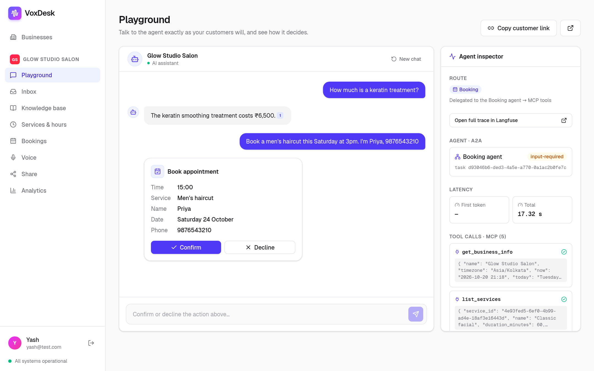
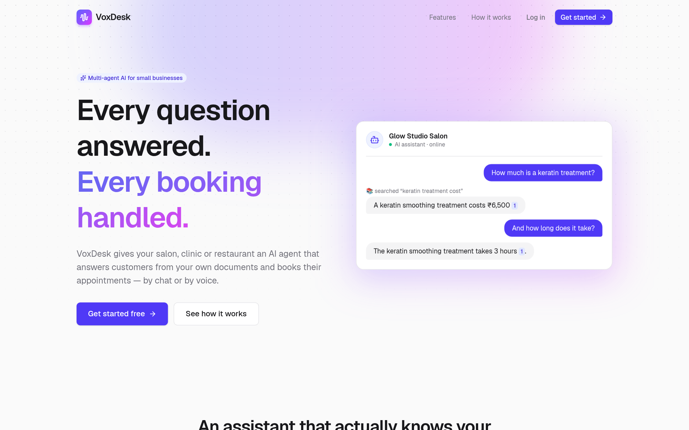
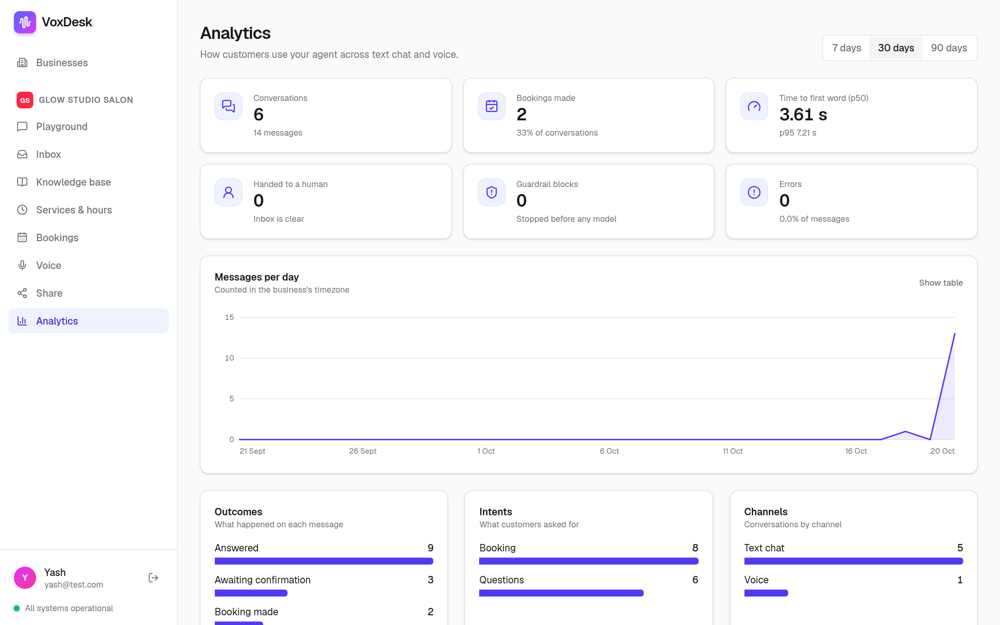
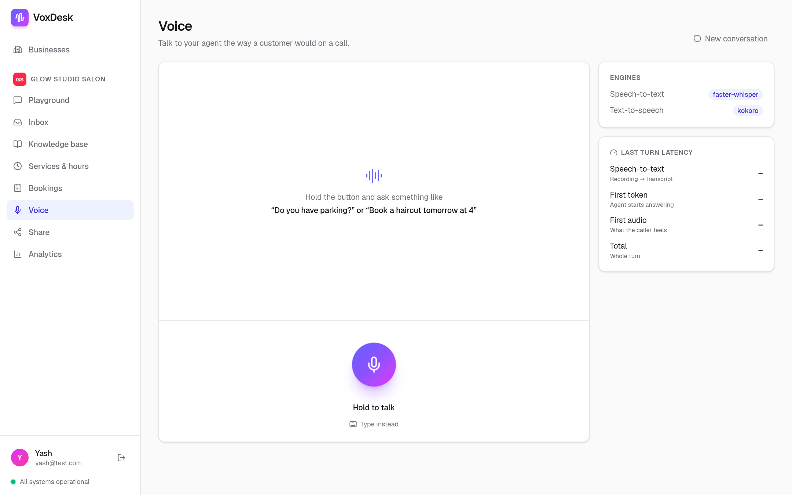
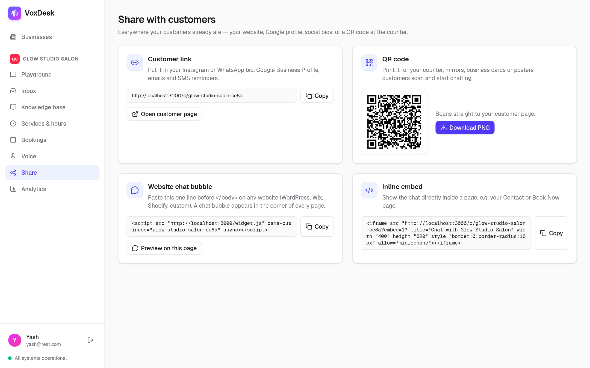
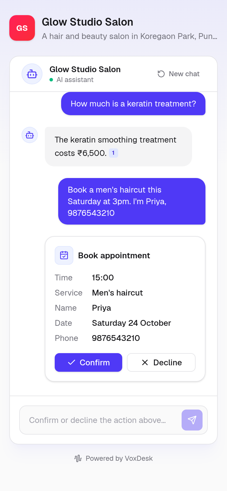

# VoxDesk

[](https://github.com/yash6388/voxdesk/actions/workflows/ci.yml)

**A multi-agent voice AI platform for businesses.** A salon, clinic or restaurant adds its documents,
services and opening hours; its customers then talk to an AI agent by **voice or chat**. The agent
answers questions from the business's own knowledge base, **books, reschedules and cancels
appointments** against real availability, and hands the conversation to staff when a person is needed.

<p align="center">
  
</p>

---

## Features

**For customers**
- 💬 **Chat and voice** — talk naturally in the browser; answers stream in as text or are spoken sentence by sentence, and you can interrupt the agent mid-sentence.
- 📚 **Grounded answers** — replies come from the business's own documents, with citations; the agent says so when it doesn't know instead of guessing.
- 📅 **Appointment booking** — checks live availability, collects name and phone, and asks for confirmation (click or say "yes") before anything is booked.
- 🙋 **Talk to a person** — asking for staff flags the conversation for the team.
- 🔗 **Available anywhere** — a public page per business, a QR code, and a one-line chat widget for any website.

**For business owners**
- 🧠 **Knowledge base** — upload PDF, Markdown or text files; they're indexed automatically.
- 🛠️ **Services & hours** — durations, prices and weekly opening hours drive what the agent can book.
- 🗓️ **Bookings** — every appointment the agent makes, with owner cancellation.
- 📥 **Inbox** — conversations where a customer asked for a person, with full transcripts.
- 📊 **Analytics** — conversations, bookings, handoffs, blocked messages, errors, response time (p50/p95), daily activity, and breakdowns by intent, outcome and channel.
- 🔍 **Playground with Agent Inspector** — test the agent and see how each reply was produced: which agent handled it, sources used, tools called, timings and a link to the full trace.

**Under the hood**
- Supervisor agent (LangGraph) delegating to specialist **Knowledge** and **Booking** agents over the **A2A** protocol
- Booking tools served by a custom **MCP** server, with a database constraint that rules out double booking
- Hybrid retrieval (pgvector + Postgres full-text, fused with RRF) — tuned with an evaluation suite
- Speech-to-text and text-to-speech run locally (faster-whisper, Kokoro) or via ElevenLabs
- Gemini with automatic failover to any OpenAI-compatible provider, behind a circuit breaker
- Accounts with tenant isolation, rate limiting, prompt-injection guardrails and Langfuse tracing

## Screenshots

| | |
|---|---|
|  **Landing page** |  **Analytics** — conversations, bookings, response time, intents and outcomes |
|  **Voice** — hold to talk; answers are spoken sentence by sentence |  **Share** — customer link, QR code and website widget |

<p align="center">
  <br/>
  <b>What customers see</b> — the public chat page on a phone
</p>

## Tech stack

| | |
|---|---|
| **Frontend** | Next.js 15, React 19, TypeScript, Tailwind CSS |
| **Backend** | Python 3.13, FastAPI, SQLAlchemy 2 (async), Alembic, uv |
| **AI** | LangGraph, LangChain, Google Gemini, Gemini embeddings, OpenAI-compatible fallback (e.g. Groq) |
| **Protocols** | Model Context Protocol (FastMCP), Agent2Agent (a2a-sdk) |
| **Voice** | faster-whisper, Kokoro (ONNX), ElevenLabs (optional), WebSockets |
| **Data** | PostgreSQL 16 + pgvector, Redis |
| **Ops** | Docker Compose, GitHub Actions, Langfuse |

## Quick start (Docker)

Requires Docker and a free [Google AI Studio API key](https://aistudio.google.com/apikey).

```bash
git clone https://github.com/yash6388/voxdesk.git
cd voxdesk
cp .env.example backend/.env      # then set GOOGLE_API_KEY
docker compose --profile app up -d --build
```

Open **http://localhost:3000**, create an account, and add a business. The first start downloads the
local speech models (~250 MB). To stop everything: `docker compose --profile app down`.

**Demo content:** `samples/` contains documents for a fictional salon ("Glow Studio") — upload them in
the Knowledge base, add a few services and hours, and try *"How much is a keratin treatment?"* or
*"Book a haircut tomorrow afternoon"* in the Playground. To fill a demo business automatically, run
`uv run python -m scripts.seed_demo` from `backend/` (development setup below).

## Development setup

**Prerequisites:** Docker, [uv](https://docs.astral.sh/uv/), Node.js 22+

```bash
cp .env.example backend/.env                  # set GOOGLE_API_KEY
cp frontend/.env.example frontend/.env.local
docker compose up -d                          # Postgres + Redis only
```

**Backend** (http://localhost:8000, API docs at `/docs`)
```bash
cd backend
uv sync
uv run alembic upgrade head
uv run python -m scripts.download_voice_models   # one-time, ~250 MB
uv run uvicorn app.main:app --reload
```

**Agent services** — MCP server and the two A2A agents, in a second terminal:
```bash
cd backend
./scripts/dev_services.sh
```

**Frontend** (http://localhost:3000)
```bash
cd frontend
npm install
npm run dev
```

The status dot at the bottom of the dashboard sidebar (or `curl localhost:8000/health/services`)
shows whether every service is reachable.

| Service | Port |
|---|---|
| Frontend | 3000 |
| API | 8000 |
| MCP booking server | 8001 |
| Knowledge agent | 8101 |
| Booking agent | 8102 |
| PostgreSQL | 5433 |
| Redis | 6380 |

## Configuration

All settings are environment variables — see [`.env.example`](.env.example) for the full list with
comments. The important ones:

| Variable | Purpose |
|---|---|
| `GOOGLE_API_KEY` | Gemini chat and embedding models (**required**) |
| `FALLBACK_API_KEY`, `FALLBACK_BASE_URL`, `FALLBACK_MODEL` | Backup LLM used automatically when Gemini fails — any OpenAI-compatible provider (Groq, OpenRouter, …) |
| `LLM_PRIMARY` | `gemini` (default) or `fallback` to make the backup model primary |
| `STT_PROVIDER`, `TTS_PROVIDER` | `local` (default) or `elevenlabs`, with `ELEVENLABS_API_KEY` |
| `LANGFUSE_PUBLIC_KEY`, `LANGFUSE_SECRET_KEY`, `LANGFUSE_BASE_URL` | Optional tracing; leave empty to disable |
| `JWT_SECRET`, `COOKIE_SECURE` | Must be changed for production — the API refuses to start with the development defaults |
| `MCP_API_KEY`, `A2A_API_KEY` | Shared secrets between the API, agents and MCP server |

## Embedding the chat widget

The **Share** page in the dashboard generates everything below for your business.

```html
<script src="https://your-voxdesk-domain/widget.js" data-business="your-business-slug" async></script>
```

This adds a chat bubble to any website. A direct link (`/c/<slug>`) and a downloadable QR code are
also available.

## Testing and quality

```bash
cd backend
uv run pytest             # 130 tests, against a real Postgres (docker compose up -d)
uv run ruff check .       # lint
uv run python -m evals.run   # evaluation suite with real models
```

The evaluation suite measures retrieval, routing, answer quality and booking behaviour on a golden
dataset. Latest results: **retrieval Hit@1 86% / Hit@3 100%**, **intent routing 100%**,
**answer faithfulness 5.0 / 5** (LLM-as-judge), **correct "I don't know" on unanswerable questions
100%**, **booking task success 100%** — full report in
[`backend/evals/reports/latest.md`](backend/evals/reports/latest.md).

CI (GitHub Actions) runs backend lint and tests with Postgres and Redis, the frontend lint, typecheck
and build, and builds both Docker images.

## Project structure

```
voxdesk/
├── backend/        FastAPI API, agents, MCP server, evaluation suite, tests
├── frontend/       Next.js dashboard, customer chat/voice pages, embeddable widget
├── samples/        Demo business documents and a sample website for the widget
├── docs/           Architecture and design notes
└── docker-compose.yml
```

## Documentation

- [Architecture](docs/ARCHITECTURE.md) — system diagrams, agent graphs, request flows, data model and key design decisions

## Author

Built by **Yash Kumar Singh** — [LinkedIn](https://www.linkedin.com/in/yash-kumarsingh/) ·
[GitHub](https://github.com/yash6388)
