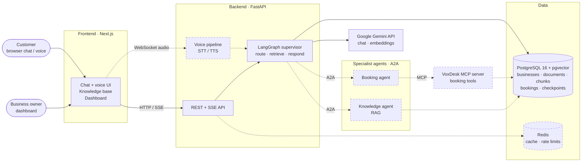
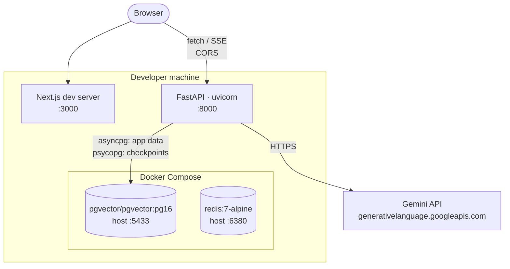
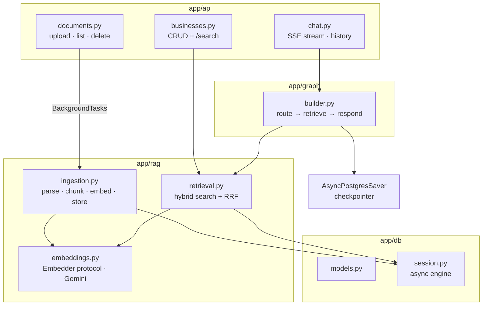
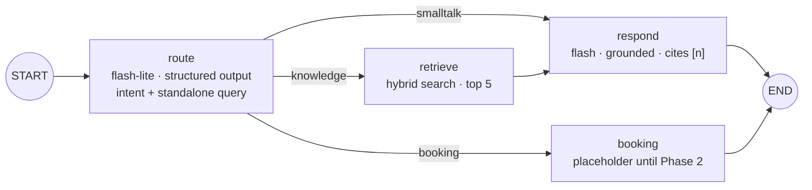
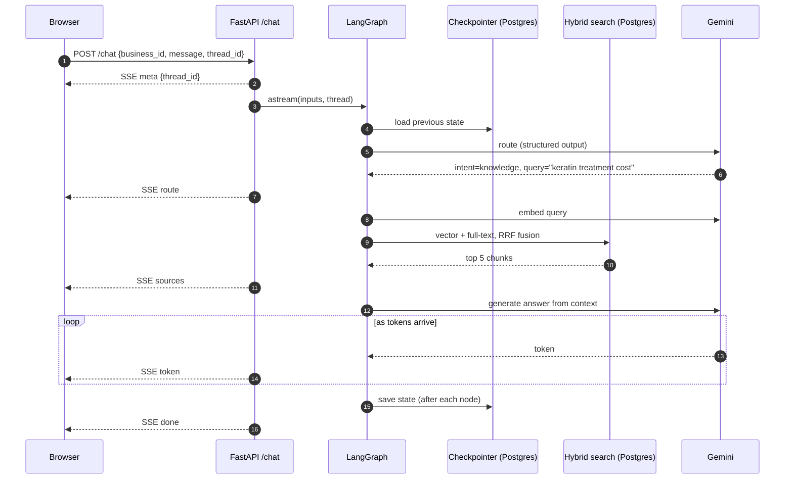
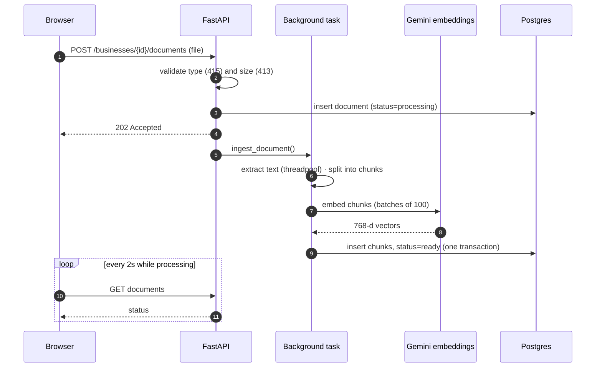
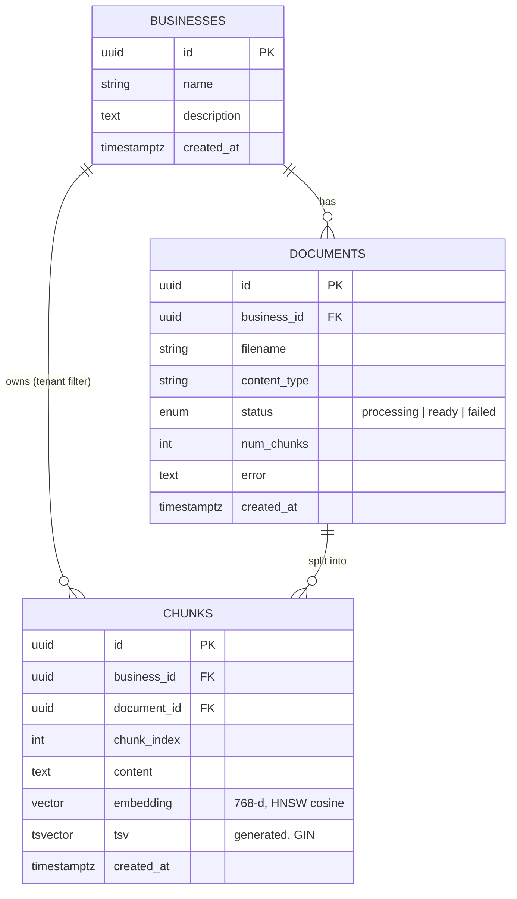

# VoxDesk — Architecture

> Living document — updated after every phase. Diagrams are [Mermaid](https://mermaid.js.org/):
> GitHub renders them automatically, and draw.io can import them (see the last section).
>
> **Status:** Phase 1 built (text chat + RAG). Components from later phases are marked *planned*.

---

## 1. System overview (target architecture)

What VoxDesk looks like when all phases are done. Solid = built, dashed = planned.



| Component | Responsibility | Tech | Status |
|---|---|---|---|
| Frontend | Landing page; dashboard: businesses, knowledge base, playground with agent inspector (later bookings, voice, analytics) | Next.js, TypeScript, Tailwind, Lucide | ✅ Phase 1 |
| API | REST endpoints, SSE streaming, validation, (later) auth | FastAPI, Pydantic | ✅ Phase 1 |
| Supervisor | Classifies intent, rewrites queries, orchestrates steps, keeps memory | LangGraph, Gemini | ✅ Phase 1 (becomes A2A client in Phase 3) |
| RAG | Ingestion + hybrid retrieval | pgvector, Postgres full-text, Gemini embeddings | ✅ Phase 1 (moves into knowledge agent in Phase 3) |
| MCP server | Booking tools usable by any MCP client | FastMCP | ⏳ Phase 2 |
| A2A agents | Independent knowledge + booking services | a2a-sdk | ⏳ Phase 3 |
| Voice | Speech in → agent → speech out | WebSocket, STT/TTS (TBD) | ⏳ Phase 4 |
| PostgreSQL | System of record + vectors + agent checkpoints | Postgres 16 + pgvector | ✅ |
| Redis | Cache, rate limiting, pub/sub | Redis 7 | Running, used from Phase 5 |

---

## 2. Current deployment (Phase 1, local)



---

## 3. Backend components (Phase 1)



---

## 4. Agent graph (LangGraph)



State is checkpointed to Postgres after every node, keyed by `{business_id}:{thread_id}`.

---

## 5. Request flows

### 5.1 Chat message (streaming)



### 5.2 Document ingestion



---

## 6. Data model



LangGraph's checkpoint tables (`checkpoints`, `checkpoint_writes`, `checkpoint_blobs`,
`checkpoint_migrations`) live in the same database and are managed by LangGraph, not Alembic.

---

## 7. Key design decisions

Full list with dates in [`PROGRESS.md`](PROGRESS.md#decision-log); explanations in
[`interview/`](interview/00_INDEX.md).

| Decision | Why |
|---|---|
| Explicit LangGraph state machine (not a free agent loop) | Predictable, testable control flow; checkpointing, streaming, interrupts built in |
| pgvector in the main Postgres | One database for app data, vectors and agent memory; SQL tenant filtering |
| Hybrid search fused with RRF | Semantic + keyword fail differently; RRF merges ranks without score normalisation |
| Router does intent + query rewrite in one call | Fewer LLM calls (latency matters for voice); follow-ups retrieve correctly |
| SSE for chat, WebSocket for voice (planned) | One-way token stream vs two-way audio stream |
| `{business_id}:{thread_id}` checkpoint keys | Tenant isolation for conversations |
| Background ingestion with 202 | Fast API responses; status polled by UI |

---

## 8. Drawing this in draw.io (or Excalidraw / Lucidchart)

**Fastest: import the Mermaid code**
1. Open [app.diagrams.net](https://app.diagrams.net) → blank diagram.
2. **Arrange → Insert → Advanced → Mermaid…**
3. Paste a diagram's code (everything between ` ```mermaid ` and ` ``` `) → **Insert**.
4. The result is editable shapes — drag to tidy the layout, recolour, add icons.
5. Save as `docs/diagrams/voxdesk-architecture.drawio` and export a PNG for the README.

**Drawing by hand (e.g. live in an interview)** — use the System overview (section 1) and keep
this left-to-right order, which matches how a request flows:

1. **Clients** — customer (chat/voice), business owner.
2. **Frontend** — Next.js.
3. **API layer** — FastAPI (REST + SSE, later WebSocket for voice).
4. **Orchestration** — LangGraph supervisor (draw the route → retrieve → respond mini-graph inside).
5. **Agents & tools** — knowledge agent, booking agent (A2A), MCP server (booking tools).
6. **Data** — Postgres + pgvector (one cylinder, list what it stores), Redis.
7. **External** — Gemini API (a cloud shape on the edge).

Conventions that make it read well: data stores as cylinders, external services as clouds, label
every arrow with the protocol (**HTTP/SSE, WebSocket, A2A, MCP, SQL**), dashed lines for async or
planned paths, and one colour per layer.
