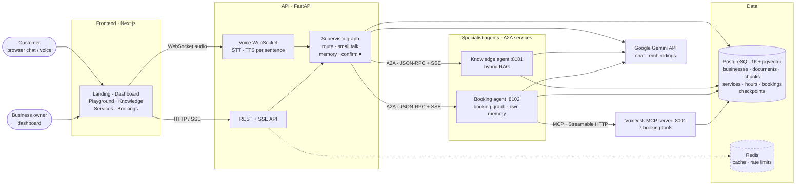
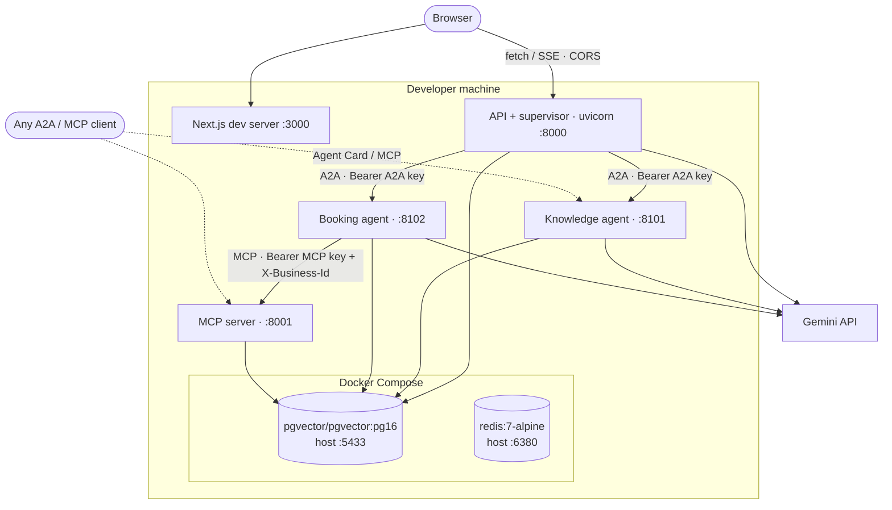
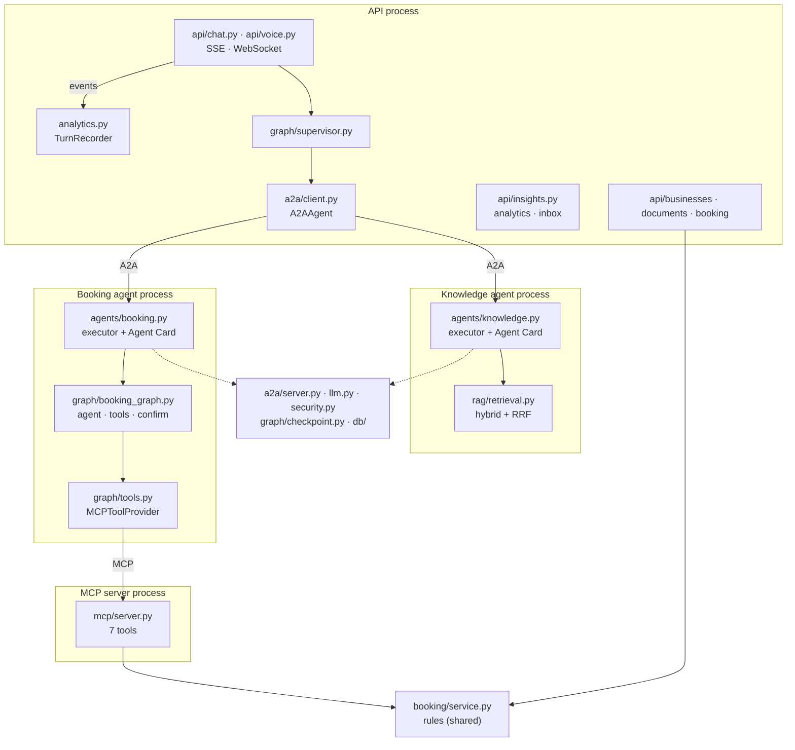
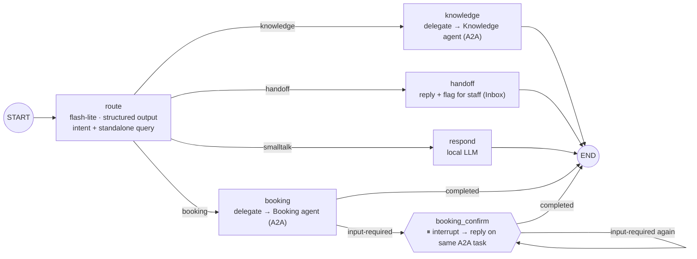
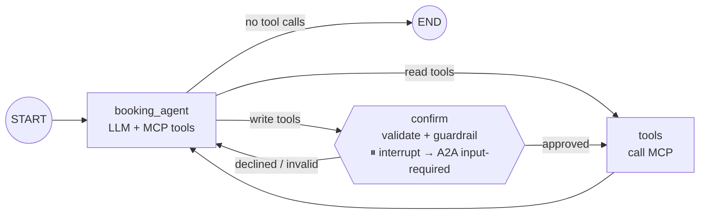
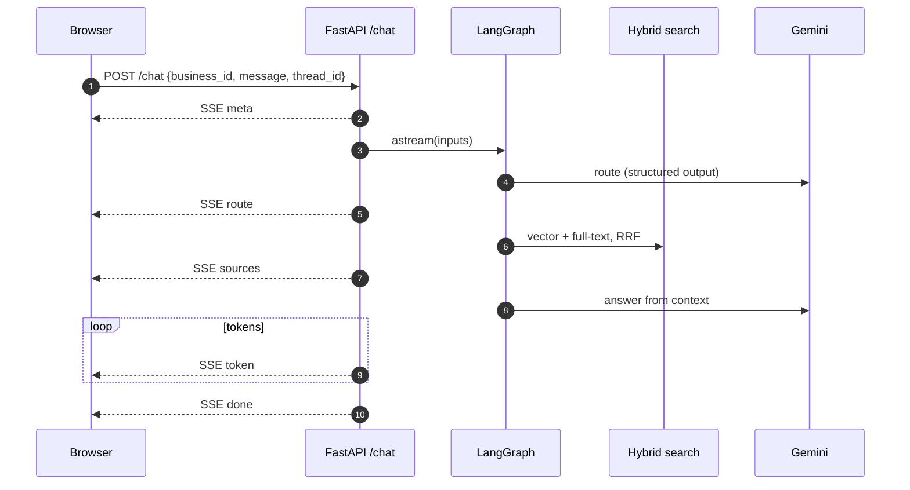
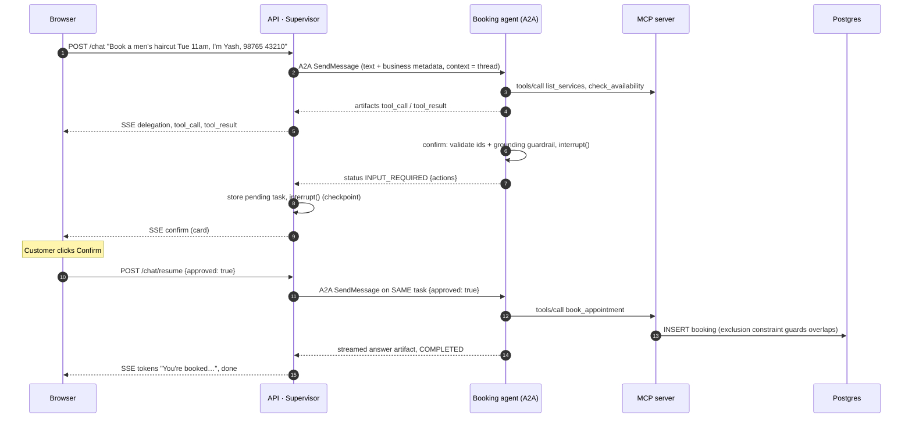
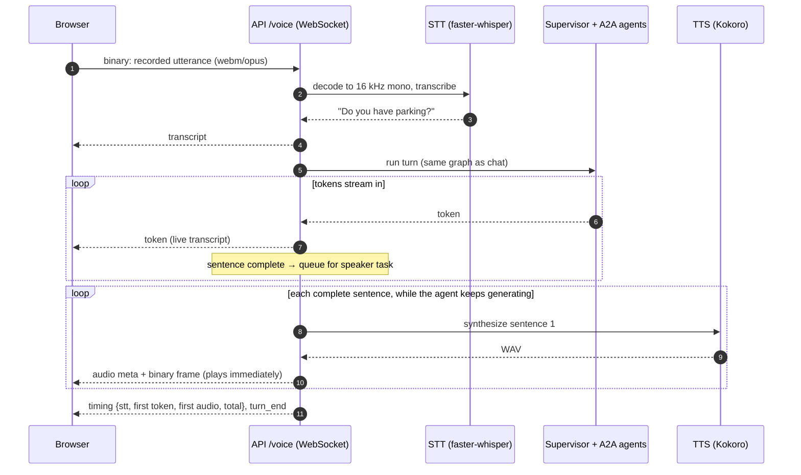
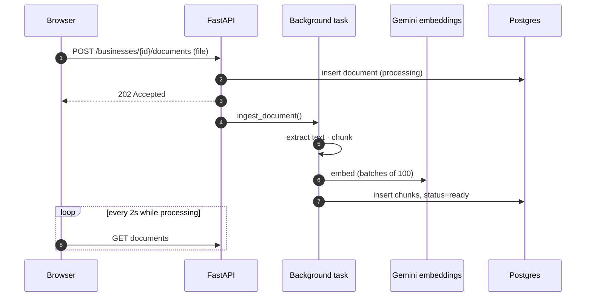
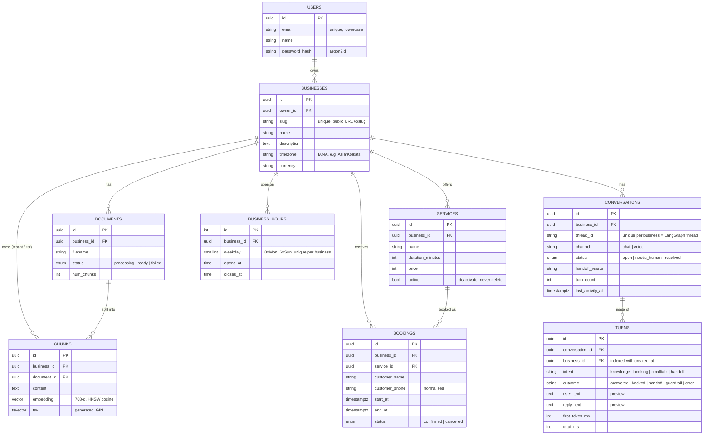

# VoxDesk — Architecture

> Living document — updated after every phase. Diagrams are [Mermaid](https://mermaid.js.org/):
> GitHub renders them automatically, and draw.io can import them (see the last section).
>
> **Status:** Phase 4 built — voice (local STT/TTS, pluggable ElevenLabs), supervisor + two A2A
> specialist agents, RAG, MCP booking with human-in-the-loop. *Planned* = Phase 5.

---

## 1. System overview (target architecture)

Solid = built, dashed = planned.



| Component | Responsibility | Tech | Status |
|---|---|---|---|
| Frontend | Landing page; dashboard: businesses, knowledge base, services & hours, bookings, playground with agent inspector (A2A agent, MCP tools) + confirmation card | Next.js, TypeScript, Tailwind, Lucide | ✅ Phase 1–3 |
| API | REST (businesses, documents, services, hours, bookings), SSE chat + resume | FastAPI, Pydantic | ✅ Phase 1–2 |
| Supervisor graph | Routing + query rewrite, small talk, conversation memory, delegation over A2A, confirmation pause | LangGraph, Gemini, a2a-sdk client | ✅ Phase 3 |
| Knowledge agent | A2A service: hybrid retrieval + grounded, streamed answer with sources | a2a-sdk, pgvector, Gemini | ✅ Phase 3 |
| Booking agent | A2A service: booking graph (LLM + MCP tools + guardrails), own memory, `input-required` for confirmation | a2a-sdk, LangGraph, langchain-mcp-adapters | ✅ Phase 3 |
| MCP server | Booking tools usable by any MCP client; auth + tenant headers | FastMCP (`mcp` SDK), Streamable HTTP | ✅ Phase 2 |
| Booking domain | Availability, validation, booking rules shared by MCP + REST | SQLAlchemy, Postgres exclusion constraint | ✅ Phase 2 |
| Voice | `/voice` WebSocket: speech → STT → supervisor → per-sentence TTS → audio; spoken confirmation; barge-in; latency metrics | faster-whisper + Kokoro (local, default) or ElevenLabs | ✅ Phase 4 |
| PostgreSQL | System of record + vectors + checkpoints (supervisor and booking agent) | Postgres 16 + pgvector + btree_gist | ✅ |
| Redis | Rate limiting (fixed-window counters) | Redis 7 | ✅ Phase 5 |
| Tracing | One trace per turn across API + A2A agents (LLM calls, tools, retrieval, STT/TTS) | Langfuse (OpenTelemetry) | ✅ Phase 5 (needs keys) |

---

## 2. Current deployment (Phase 3, local)



Run locally: `docker compose up -d`, `./scripts/dev_services.sh` (MCP + both agents), the API
(`uvicorn app.main:app --reload`) and the frontend (`npm run dev`) — **or everything in containers:
`docker compose --profile app up -d --build`** (one backend image runs as `api`, `mcp`, `knowledge`,
`booking`; plus `frontend`, `postgres`, `redis`; healthchecks gate start-up order; services reach each
other by name, e.g. `http://knowledge:8101`).

---

## 3. Backend components



All four processes share one Python package (`backend/app`) — one codebase, separately deployable
services. Booking rules live once in `app/booking/service.py`.

---

## 4. Agent graphs (LangGraph)

### 4.1 Supervisor (API)



### 4.2 Booking agent (inside the Booking agent service)



Supervisor state is checkpointed under `{business_id}:{thread_id}`; the booking agent's under
`booking:{context_id}` (same Postgres, separate threads).

---

## 5. Request flows

### 5.1 Knowledge question (streaming)



### 5.2 Booking with human-in-the-loop (across agents)



### 5.3 Voice turn (sentence-by-sentence speech)



### 5.4 Document ingestion



---

## 6. Data model



Key constraint: `bookings` has `EXCLUDE USING gist (business_id WITH =, tstzrange(start_at, end_at, '[)') WITH &&) WHERE (status = 'confirmed')`
— the database rejects overlapping confirmed bookings, even under concurrent requests.

`conversations`/`turns` are written by `TurnRecorder` with one upsert per turn
(`INSERT … ON CONFLICT (business_id, thread_id) DO UPDATE`); full transcripts are **not** copied —
the Inbox reads them from the LangGraph checkpoint.

LangGraph's checkpoint tables live in the same database and are managed by LangGraph, not Alembic.

---

## 7. Key design decisions

Full list with dates in [`PROGRESS.md`](PROGRESS.md#decision-log); explanations in
[`interview/`](interview/00_INDEX.md).

| Decision | Why |
|---|---|
| Explicit LangGraph state machine | Predictable, testable control flow; checkpointing, streaming, interrupts built in |
| pgvector in the main Postgres | One database for app data, vectors and agent memory; SQL tenant filtering |
| Hybrid search fused with RRF | Semantic + keyword fail differently; RRF merges ranks without score normalisation |
| Booking tools as a separate MCP server | Decoupled, independently deployable/securable, usable by any MCP client |
| Tenant via MCP connection header, not tool args | The LLM can't choose (or be tricked into) another business |
| Human-in-the-loop only for write tools | Safety for real-world actions without confirmation fatigue |
| Guardrail validates write args before asking the human | LLMs ignore prompt rules sometimes; invariants are enforced in code |
| Exclusion constraint for bookings | Only the database can prevent double booking under concurrency |
| Booking agent sees last 3 full turns | Reuses real ids from earlier tool results instead of guessing |
| Specialists as A2A services, supervisor keeps the conversation | Independent scaling/deployment, failure isolation, least privilege, interoperability |
| Supervisor sends the rewritten standalone query to the knowledge agent | Knowledge agent stays stateless and simple |
| Booking confirmation = A2A `input-required` + supervisor `interrupt()` | HITL maps onto the protocol's task lifecycle; UI/API contract unchanged |
| Business info as metadata on every A2A message | A2A doesn't persist request metadata across messages |
| Agent Card public, JSON-RPC bearer-protected | Discovery is the point of a card; calling needs credentials |
| Owner auth: JWT in httpOnly cookie; owner-only routers return 404 for other tenants | XSS-safe sessions, tenant isolation, no id enumeration |
| Public customer page by slug; chat/voice endpoints public | Customers never need an account |
| Langfuse tracing with trace ids passed over A2A | Debug a multi-agent, multi-process turn as one timeline |
| SSE for chat, WebSocket for voice | One-way token stream vs two-way audio + control stream |
| Local STT/TTS by default, ElevenLabs by config | Free/private/no quotas for dev; best quality when needed; same interface |
| Per-sentence TTS pipelined with LLM streaming | Caller hears the first sentence long before the answer is finished |
| Chunk size 500/100 chosen by the evaluation suite | Hit@1 86% vs 82% at 1000 (equal overlap) |
| LLM fallback: Gemini → any OpenAI-compatible provider (chat only, not embeddings) | Survive provider outages/quotas; embeddings must stay one model to remain comparable |
| Analytics derived from the client event stream (`TurnRecorder`) | Same code for chat and voice; graph and agents know nothing about analytics |
| Handoff = route → flag `needs_human` → Inbox; no repeat handoff (rule in code) | Real follow-up workflow without a live takeover console; router LLM was unreliable on follow-ups |
| Decode audio with PyAV directly | faster-whisper's helper is incompatible with current PyAV; also format-agnostic |

---

## 8. Drawing this in draw.io (or Excalidraw / Lucidchart)

**Fastest: import the Mermaid code**
1. Open [app.diagrams.net](https://app.diagrams.net) → blank diagram.
2. **Arrange → Insert → Advanced → Mermaid…**
3. Paste a diagram's code (everything between ` ```mermaid ` and ` ``` `) → **Insert**.
4. The result is editable shapes — drag to tidy the layout, recolour, add icons.
5. Save as `docs/diagrams/voxdesk-architecture.drawio` and export a PNG for the README.

**Drawing by hand (e.g. live in an interview)** — use the System overview (section 1), left to right:

1. **Clients** — customer (chat/voice), business owner.
2. **Frontend** — Next.js.
3. **API layer** — FastAPI (REST + SSE; later WebSocket for voice).
4. **Orchestration** — LangGraph supervisor (route → delegate, ⏸ confirm).
5. **Agents & tools** — Knowledge agent and Booking agent (A2A); the booking agent calls the MCP server (tools).
6. **Data** — Postgres + pgvector (one cylinder, list what it stores), Redis.
7. **External** — Gemini API (cloud shape).

Conventions: data stores as cylinders, external services as clouds, label every arrow with its
protocol (**HTTP/SSE, WebSocket, MCP, A2A, SQL**), dashed lines for async or planned paths, one
colour per layer.
