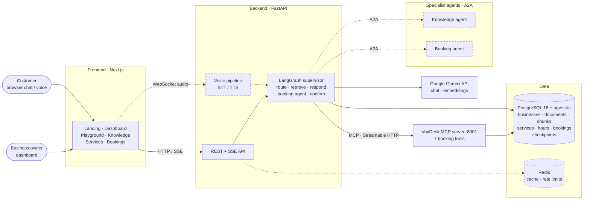
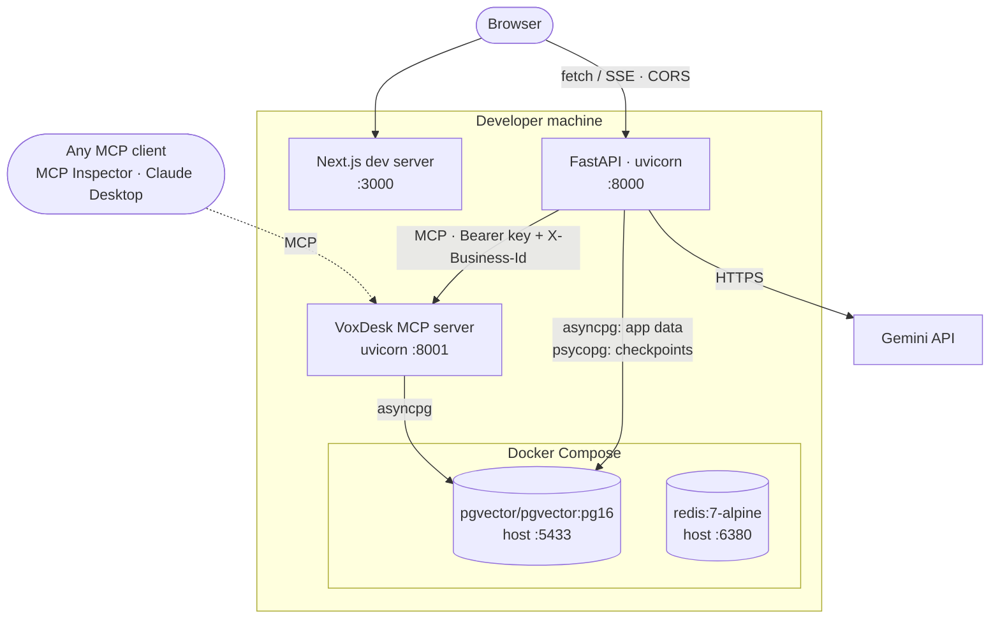
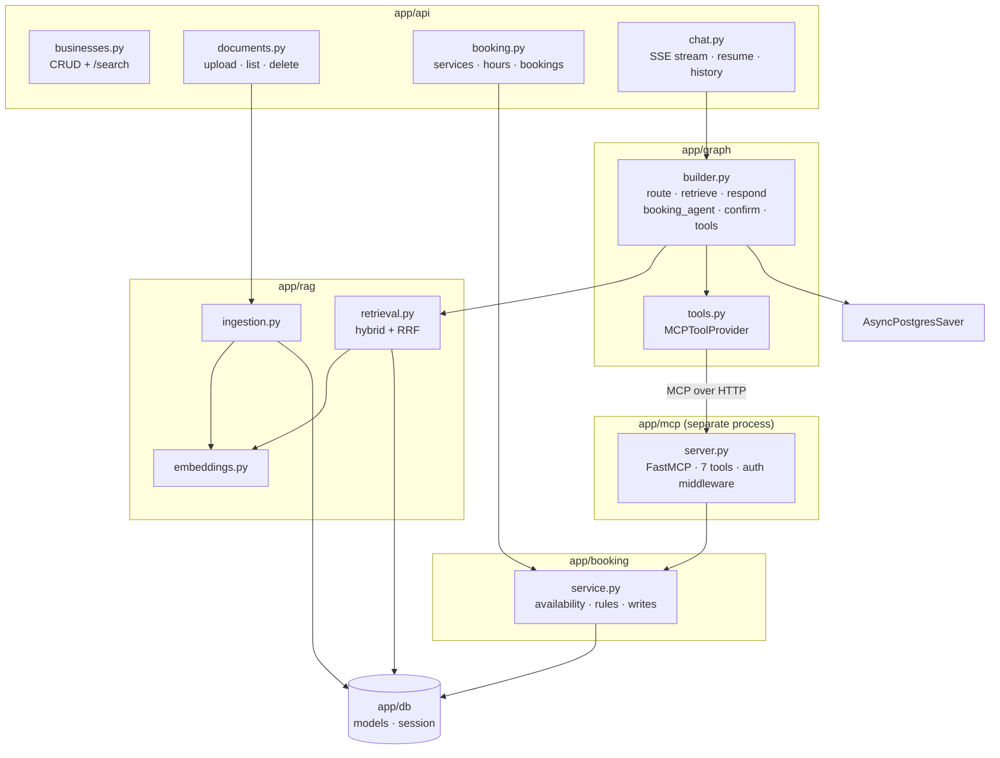
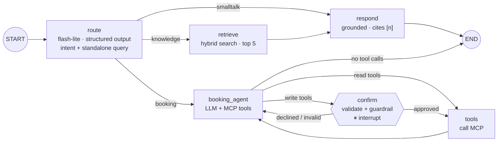
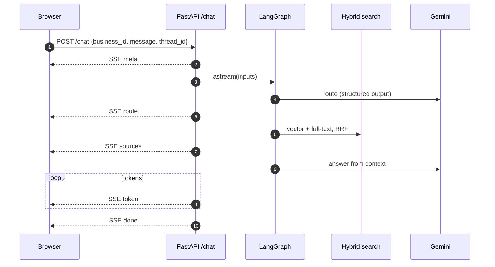
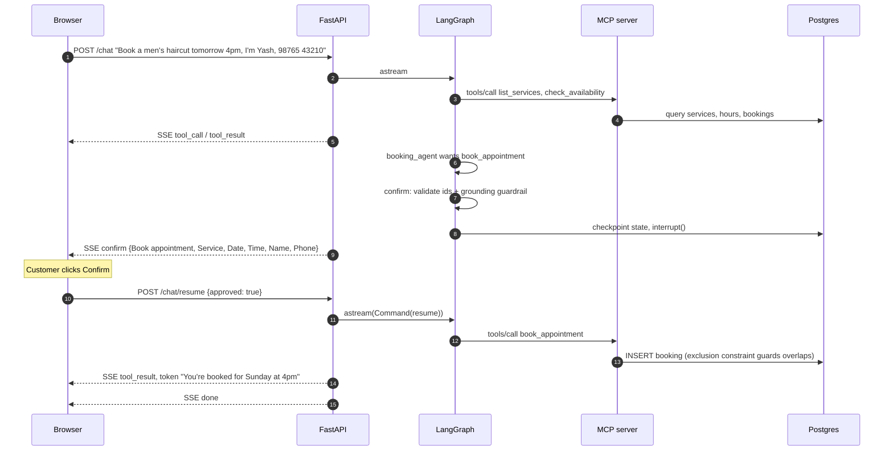
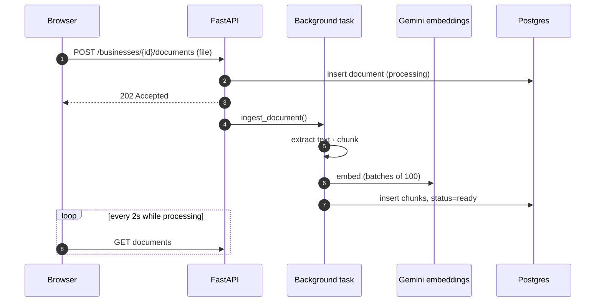
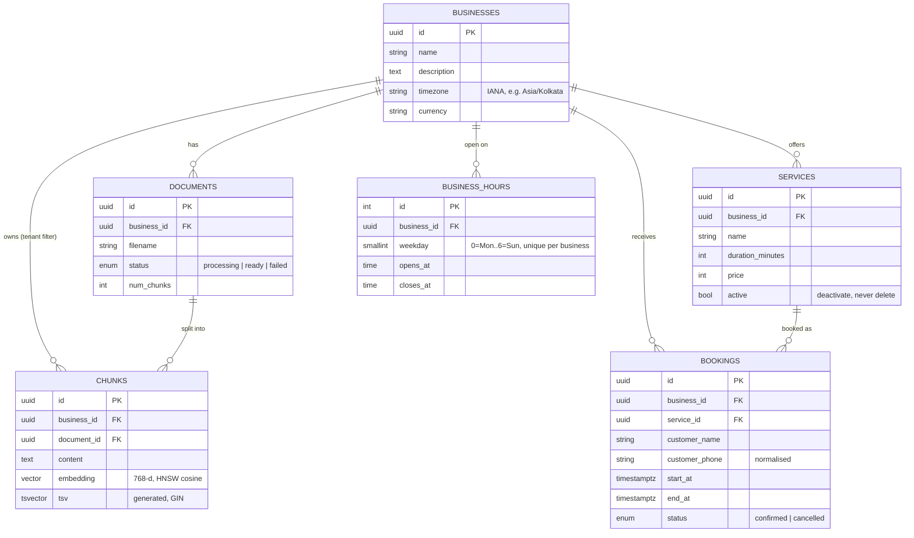

# VoxDesk — Architecture

> Living document — updated after every phase. Diagrams are [Mermaid](https://mermaid.js.org/):
> GitHub renders them automatically, and draw.io can import them (see the last section).
>
> **Status:** Phase 2 built (text chat + RAG + MCP booking with human-in-the-loop).
> Components from later phases are marked *planned*.

---

## 1. System overview (target architecture)

Solid = built, dashed = planned.



| Component | Responsibility | Tech | Status |
|---|---|---|---|
| Frontend | Landing page; dashboard: businesses, knowledge base, services & hours, bookings, playground with agent inspector + confirmation card | Next.js, TypeScript, Tailwind, Lucide | ✅ Phase 1–2 |
| API | REST (businesses, documents, services, hours, bookings), SSE chat + resume | FastAPI, Pydantic | ✅ Phase 1–2 |
| Supervisor graph | Routes intent, rewrites queries, RAG, booking agent loop, human-in-the-loop, memory | LangGraph, Gemini | ✅ Phase 1–2 (agents split out via A2A in Phase 3) |
| RAG | Ingestion + hybrid retrieval | pgvector, Postgres full-text, Gemini embeddings | ✅ Phase 1 |
| MCP server | Booking tools usable by any MCP client; auth + tenant headers | FastMCP (`mcp` SDK), Streamable HTTP | ✅ Phase 2 |
| Booking domain | Availability, validation, booking rules shared by MCP + REST | SQLAlchemy, Postgres exclusion constraint | ✅ Phase 2 |
| A2A agents | Independent knowledge + booking services | a2a-sdk | ⏳ Phase 3 |
| Voice | Speech in → agent → speech out | WebSocket, STT/TTS (TBD) | ⏳ Phase 4 |
| PostgreSQL | System of record + vectors + agent checkpoints | Postgres 16 + pgvector + btree_gist | ✅ |
| Redis | Cache, rate limiting, pub/sub | Redis 7 | Running, used from Phase 5 |

---

## 2. Current deployment (Phase 2, local)



Processes to run locally: `docker compose up -d`, the API (`uvicorn app.main:app`), the MCP server
(`python -m app.mcp.server`) and the frontend (`npm run dev`).

---

## 3. Backend components



The booking rules live once in `app/booking/service.py` and are used by both the MCP server
(customers, via the agent) and the owner REST API.

---

## 4. Agent graph (LangGraph)



State is checkpointed to Postgres after every node, keyed by `{business_id}:{thread_id}`, which is
what lets `confirm` pause and resume in a later HTTP request.

---

## 5. Request flows

### 5.1 Knowledge question (streaming)



### 5.2 Booking with human-in-the-loop



### 5.3 Document ingestion



---

## 6. Data model



Key constraint: `bookings` has `EXCLUDE USING gist (business_id WITH =, tstzrange(start_at, end_at, '[)') WITH &&) WHERE (status = 'confirmed')`
— the database rejects overlapping confirmed bookings, even under concurrent requests.

LangGraph's checkpoint tables live in the same database and are managed by LangGraph, not Alembic.

---

## 7. Key design decisions

Full list with dates in [`PROGRESS.md`](PROGRESS.md#decision-log); explanations in
[`interview/`](interview/00_INDEX.md).

| Decision | Why |
|---|---|
| Explicit LangGraph state machine | Predictable, testable control flow; checkpointing, streaming, interrupts built in |
| pgvector in the main Postgres | One database for app data, vectors and agent memory; SQL tenant filtering |
| Hybrid search fused with RRF | Semantic + keyword fail differently; RRF merges ranks without score normalisation |
| Booking tools as a separate MCP server | Decoupled, independently deployable/securable, usable by any MCP client |
| Tenant via MCP connection header, not tool args | The LLM can't choose (or be tricked into) another business |
| Human-in-the-loop only for write tools | Safety for real-world actions without confirmation fatigue |
| Guardrail validates write args before asking the human | LLMs ignore prompt rules sometimes; invariants are enforced in code |
| Exclusion constraint for bookings | Only the database can prevent double booking under concurrency |
| Booking agent sees last 3 full turns | Reuses real ids from earlier tool results instead of guessing |
| SSE for chat, WebSocket for voice (planned) | One-way token stream vs two-way audio stream |

---

## 8. Drawing this in draw.io (or Excalidraw / Lucidchart)

**Fastest: import the Mermaid code**
1. Open [app.diagrams.net](https://app.diagrams.net) → blank diagram.
2. **Arrange → Insert → Advanced → Mermaid…**
3. Paste a diagram's code (everything between ` ```mermaid ` and ` ``` `) → **Insert**.
4. The result is editable shapes — drag to tidy the layout, recolour, add icons.
5. Save as `docs/diagrams/voxdesk-architecture.drawio` and export a PNG for the README.

**Drawing by hand (e.g. live in an interview)** — use the System overview (section 1), left to right:

1. **Clients** — customer (chat/voice), business owner.
2. **Frontend** — Next.js.
3. **API layer** — FastAPI (REST + SSE; later WebSocket for voice).
4. **Orchestration** — LangGraph supervisor (sketch route → retrieve/respond and booking_agent ⇄ tools with a ⏸ confirm).
5. **Tools & agents** — MCP server (booking tools); later A2A knowledge + booking agents.
6. **Data** — Postgres + pgvector (one cylinder, list what it stores), Redis.
7. **External** — Gemini API (cloud shape).

Conventions: data stores as cylinders, external services as clouds, label every arrow with its
protocol (**HTTP/SSE, WebSocket, MCP, A2A, SQL**), dashed lines for async or planned paths, one
colour per layer.
